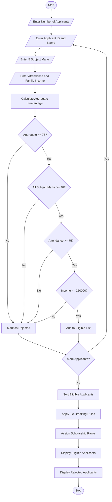

# 1. University Scholarship Allocation System (Python)

## 1. Problem Statement

The University Scholarship Allocation System is designed to identify and rank eligible students for scholarships based on their academic performance, attendance percentage, and family income.

The system evaluates each applicant using the following criteria:

1. Aggregate Marks: The student must obtain at least 75% aggregate marks.
2. Subject-wise Minimum Marks: The student must score at least 40 marks in every subject.
3. Attendance: The student must have at least 75% attendance.
4. Family Income: The annual family income must not exceed ₹2,50,000.

After checking all eligibility conditions, the system selects eligible students and ranks them according to predefined tie-breaking rules.

Tie-breaking rules:

- First priority: Higher aggregate marks.
- Second priority: Higher attendance percentage.
- Third priority: Lower family income.
- Fourth priority: Applicant ID in ascending order.

The system finally displays the eligible students, their scholarship ranks, and the rejected applicants with their reasons for rejection.

## 2. Algorithm

1. Start the program.
2. Read the number of scholarship applicants.
3. For each applicant:
   - Read applicant ID and name.
   - Read marks in five subjects.
   - Read attendance percentage.
   - Read annual family income.
4. Calculate the aggregate percentage.
5. Check the eligibility conditions:
   - Aggregate percentage ≥ 75%.
   - Every subject mark ≥ 40.
   - Attendance ≥ 75%.
   - Annual family income ≤ ₹2,50,000.
6. If all conditions are satisfied, add the applicant to the eligible list.
7. Otherwise, display the reasons for rejection.
8. Sort eligible applicants using the tie-breaking rules.
9. Assign ranks to eligible applicants.
10. Display the scholarship allocation results.
11. Stop the program.

## 3. Flowchart


## 4. Python Source Code

```
# University Scholarship Allocation Systemapplicants = []eligible = []rejected = []# Scholarship Eligibility CriteriaMIN_AGGREGATE = 75MIN_SUBJECT_MARKS = 40MIN_ATTENDANCE = 75MAX_INCOME = 250000n = int(input("Enter number of applicants: "))# Collect Applicant Detailsfor i in range(n):    print("\nEnter details of Applicant", i + 1)    app_id = int(input("Applicant ID: "))    name = input("Applicant Name: ")    marks = []    print("Enter marks in 5 subjects:")    for j in range(5):        mark = float(input(f"Subject {j + 1}: "))        if mark < 0 or mark > 100:            raise ValueError("Marks must be between 0 and 100.")        marks.append(mark)    attendance = float(input("Attendance Percentage: "))
```

## 5. Sample Input

Consider the following three applicants.

SAMPLE APPLICANT DATA

| Details       | Applicant 1 | Applicant 2 | Applicant 3 |
| ------------- | ----------- | ----------- | ----------- |
| Applicant ID  | 101         | 102         | 103         |
| Name          | Arun        | Banu        | Charan      |
| Subject 1     | 90          | 85          | 95          |
| Subject 2     | 85          | 80          | 90          |
| Subject 3     | 88          | 82          | 85          |
| Subject 4     | 92          | 78          | 88          |
| Subject 5     | 85          | 85          | 92          |
| Attendance    | 90%         | 95%         | 70%         |
| Annual Income | 200000      | 180000      | 150000      |
| Aggregate     | 88%         | 82%         | 90%         |

Console input:

```
Enter number of applicants: 3

Enter details of Applicant 1
Applicant ID: 101
Applicant Name: Arun
Enter marks in 5 subjects:
Subject 1: 90
Subject 2: 85
Subject 3: 88
Subject 4: 92
Subject 5: 85
Attendance Percentage: 90
Annual Family Income: 200000

Enter details of Applicant 2
Applicant ID: 102
Applicant Name: Banu
Enter marks in 5 subjects:
Subject 1: 85
Subject 2: 80
Subject 3: 82
Subject 4: 78
Subject 5: 85
Attendance Percentage: 95
Annual Family Income: 180000

Enter details of Applicant 3
Applicant ID: 103
Applicant Name: Charan
Enter marks in 5 subjects:
Subject 1: 95
Subject 2: 90
Subject 3: 85
Subject 4: 88
Subject 5: 92
Attendance Percentage: 70
Annual Family Income: 150000
```

## 6. Sample Output

```
========== SCHOLARSHIP ALLOCATION REPORT ==========

ELIGIBLE APPLICANTS

--------------------------------------------------------------------------
Rank    ID        Name           Aggregate    Attendance   Income
--------------------------------------------------------------------------
1       101       Arun           88.00        90.00        Rs.200000.00
2       102       Banu           82.00        95.00        Rs.180000.00

REJECTED APPLICANTS

ID: 103
Name: Charan
Reason(s): Attendance below 75%

========== END OF REPORT ==========
```

Output Explanation:

- Arun is eligible because he satisfies all four conditions and gets Rank 1.
- Banu is eligible because he satisfies all four conditions and gets Rank 2.
- Charan is rejected because his attendance is only 70%, which is below the required 75%.

## 7. Mermaid Flowchart Code


## 8. Concepts Used in This Project

| Python concept         | Application                        |
| ---------------------- | ---------------------------------- |
| Variables              | Store applicant details            |
| Lists                  | Store subject marks and applicants |
| Dictionaries           | Store individual applicant records |
| For loop               | Read multiple applicants           |
| If-else                | Check eligibility                  |
| Functions              | `sum()`, `any()`, `sort()`         |
| Lambda                 | Apply ranking criteria             |
| Sorting                | Rank eligible students             |
| Conditional statements | Identify rejection reasons         |

Time Complexity:

- Eligibility checking: \\(O(n)\\), assuming five subjects per applicant.
- Ranking: \\(O(n \log n)\\) in the worst case.
- Overall: \\(O(n \log n)\\).

Here, \\(n\\) represents the number of applicants.

Final Result: This project automatically evaluates scholarship applicants, identifies eligible students, rejects applicants who fail the criteria, and ranks eligible students according to predefined tie-breaking rules.
