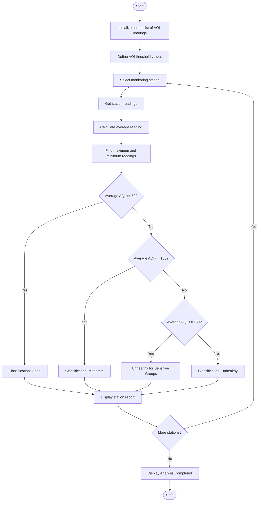

# Environmental Monitoring Data Analyzer – Python Program

## 1. Problem Statement

Develop a Python program to analyse environmental monitoring data using nested lists containing air-quality or water-quality readings from multiple monitoring stations.

The program should:

1. Store environmental readings from multiple monitoring stations using nested lists.
2. Calculate the average reading for each station.
3. Identify the maximum and minimum readings.
4. Compare readings with the supplied threshold values.
5. Classify observations into different environmental quality categories.
6. Display a summary report for all monitoring stations.

Classification rules (Air Quality Example):

| AQI Value | Classification                 |
| --------- | ------------------------------ |
| 0–50      | Good                           |
| 51–100    | Moderate                       |
| 101–150   | Unhealthy for Sensitive Groups |
| Above 150 | Unhealthy                      |

## 2. Algorithm

1. Start the program.
2. Initialize a nested list containing environmental readings from different monitoring stations.
3. Define the classification threshold values.
4. Read the number of monitoring stations.
5. For each station:
   - Calculate the average reading.
   - Find the maximum reading.
   - Find the minimum reading.
6. Compare the average reading with the threshold values.
7. Classify the environmental condition.
8. Display the station name, readings, average, maximum, minimum, and classification.
9. Repeat the process for all stations.
10. Stop the program.

## 3. Flowchart

## 4. Python Source Code

```
# Environmental Monitoring Data Analyzer# Nested list containing AQI readingsstations = [    ["Station 1", [35, 45, 50, 40]],    ["Station 2", [65, 75, 85, 90]],    ["Station 3", [110, 125, 135, 145]],    ["Station 4", [160, 175, 185, 195]]]# Function to classify environmental readingsdef classify_aqi(aqi):    if aqi <= 50:        return "Good"    elif aqi <= 100:        return "Moderate"    elif aqi <= 150:        return "Unhealthy for Sensitive Groups"    else:        return "Unhealthy"# Display reportprint("ENVIRONMENTAL MONITORING REPORT")print("------------------------------------------")for station in stations:    name = station[0]    readings = station[1]    # Calculate average, maximum and minimum    average = sum(readings) / len(readings)    maximum = max(readings)    minimum = min(readings)
```

## 5. Sample Input

The following nested list is used as input:

```
Number of monitoring stations: 4

Station 1: 35, 45, 50, 40
Station 2: 65, 75, 85, 90
Station 3: 110, 125, 135, 145
Station 4: 160, 175, 185, 195
```

## 6. Sample Output

```
ENVIRONMENTAL MONITORING REPORT
------------------------------------------

Station: Station 1
Readings: [35, 45, 50, 40]
Average AQI: 42.5
Maximum AQI: 50
Minimum AQI: 35
Environmental Condition: Good

Station: Station 2
Readings: [65, 75, 85, 90]
Average AQI: 78.75
Maximum AQI: 90
Minimum AQI: 65
Environmental Condition: Moderate

Station: Station 3
Readings: [110, 125, 135, 145]
Average AQI: 128.75
Maximum AQI: 145
Minimum AQI: 110
Environmental Condition: Unhealthy for Sensitive Groups

Station: Station 4
Readings: [160, 175, 185, 195]
Average AQI: 178.75
Maximum AQI: 195
Minimum AQI: 160
Environmental Condition: Unhealthy

Analysis Completed.
```

## 7. Mermaid Flowchart Code


Result: The Python program successfully analyses environmental monitoring data using nested lists, calculates average and extreme values, classifies environmental conditions based on threshold values, and generates a monitoring report.
