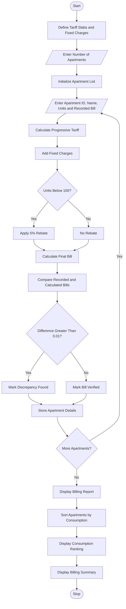

# Smart Electricity Billing for Multiple Apartments

## 1. Problem Statement

Develop a Python-based Smart Electricity Billing System for multiple apartments. The system calculates electricity bills for each apartment based on units consumed using progressive tariff rates, fixed charges, and applicable rebates.

The system should:

- Accept apartment ID, resident name, and electricity consumption.
- Calculate electricity charges using progressive tariff slabs.
- Add fixed monthly charges.
- Apply rebates for eligible apartments.
- Identify billing discrepancies by comparing calculated bills with recorded bills.
- Rank apartments based on electricity consumption.
- Generate a final electricity billing report.

## 2. Algorithm

1. Start the program.
2. Define electricity tariff slabs and fixed charges.
3. Get the number of apartments.
4. For each apartment:
   - Read apartment ID.
   - Read resident name.
   - Read electricity units consumed.
   - Read recorded bill amount.
5. Calculate electricity charges using progressive tariffs.
6. Add fixed charges to the electricity bill.
7. Apply a 5% rebate if consumption is below 100 units.
8. Calculate the final bill.
9. Compare the calculated bill with the recorded bill.
10. Identify billing discrepancies.
11. Sort apartments in descending order of electricity consumption.
12. Display apartment-wise billing details and rankings.
13. Stop the program.

## 3. Flowchart


## 4. Python Source Code

```
        status = "Discrepancy Found"    else:        status = "Bill Verified"    apartments.append({        "id": apt_id,        "name": name,        "units": units,        "energy": energy,        "fixed": fixed,        "rebate": rebate,        "final": final,        "recorded": recorded_bill,        "difference": difference,        "status": status    })# Display apartment-wise billing reportprint("\n========== ELECTRICITY BILLING REPORT ==========")for apt in apartments:    print("\nApartment ID:", apt["id"])    print("Resident Name:", apt["name"])    print("Units Consumed:", apt["units"])    print("Energy Charges: Rs.", round(apt["energy"], 2))    print("Fixed Charges: Rs.", round(apt["fixed"], 2))    print("Rebate: Rs.", round(apt["rebate"], 2))    print("Calculated Bill: Rs.", round(apt["final"], 2))    print("Recorded Bill: Rs.", round(apt["recorded"], 2))    print("Difference: Rs.", round(apt["difference"], 2))    print("Status:", apt["status"])# Rank apartments by consumptionranked = sorted(    apartments,    key=lambda x: x["units"],    reverse=True)print("\n========== CONSUMPTION RANKING ==========")for rank, apt in enumerate(ranked, start=1):    print(        rank, ".", apt["id"],        "-", apt["name"],        "-", apt["units"], "units"    )print("\n========== BILLING SUMMARY ==========")discrepancies = sum(    1 for apt in apartments    if apt["status"] == "Discrepancy Found")print("Total Apartments:", n)print("Verified Bills:", n - discrepancies)print("Discrepant Bills:", discrepancies)print("\nElectricity Billing Process Completed!")
```

## 5. Sample Input

```
Enter number of apartments: 3

Enter details of Apartment 1
Apartment ID: A101
Resident Name: Rahul
Units Consumed: 80
Recorded Bill Amount: 202.00

Enter details of Apartment 2
Apartment ID: A102
Resident Name: Priya
Units Consumed: 150
Recorded Bill Amount: 400.00

Enter details of Apartment 3
Apartment ID: A103
Resident Name: Arun
Units Consumed: 250
Recorded Bill Amount: 950.00
```

## 6. Sample Output

```
========== ELECTRICITY BILLING REPORT ==========

Apartment ID: A101
Resident Name: Rahul
Units Consumed: 80
Energy Charges: Rs. 160
Fixed Charges: Rs. 50
Rebate: Rs. 10.5
Calculated Bill: Rs. 199.5
Recorded Bill: Rs. 202.0
Difference: Rs. 2.5
Status: Discrepancy Found

Apartment ID: A102
Resident Name: Priya
Units Consumed: 150
Energy Charges: Rs. 350
Fixed Charges: Rs. 50
Rebate: Rs. 0
Calculated Bill: Rs. 400
Recorded Bill: Rs. 400
Difference: Rs. 0
Status: Bill Verified

Apartment ID: A103
Resident Name: Arun
Units Consumed: 250
Energy Charges: Rs. 750
Fixed Charges: Rs. 50
Rebate: Rs. 0
Calculated Bill: Rs. 800
Recorded Bill: Rs. 950
Difference: Rs. 150
Status: Discrepancy Found

========== CONSUMPTION RANKING ==========

1. A103 - Arun - 250 units
2. A102 - Priya - 150 units
3. A101 - Rahul - 80 units

========== BILLING SUMMARY ==========

Total Apartments: 3
Verified Bills: 1
Discrepant Bills: 2

Electricity Billing Process Completed!
```

## 7. Mermaid Flowchart Code


## 8. Tariff Structure Used

| Electricity consumption | Rate per unit |
| ----------------------- | ------------- |
| 0–100 units             | ₹2            |
| 101–200 units           | ₹3            |
| 201–300 units           | ₹5            |
| Above 300 units         | ₹7            |

- Fixed monthly charge: ₹50
- Rebate: 5% for consumption below 100 units.
- Discrepancy tolerance: ₹0.01.

Note: These are assumed tariff rates for this academic project, not official electricity-board rates.
