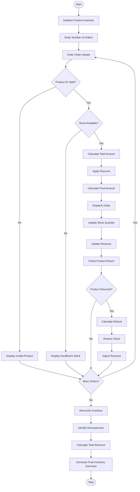

# Integrated E-Commerce Order Processing and Reconciliation – Python Program

## 1. Problem Statement

Develop an Integrated E-Commerce Order Processing and Reconciliation System using Python to manage customer orders, product discounts, dispatches, returns, and inventory updates.

The system should:

1. Accept product details, prices, quantities, and stock availability.
2. Process customer orders and calculate discounts.
3. Calculate the final order amount after discounts.
4. Update stock quantities after successful dispatch.
5. Process product returns and restore stock.
6. Calculate total revenue from completed orders.
7. Identify discrepancies between expected and actual inventory.
8. Generate a final inventory summary showing available stock, dispatched products, returned products, and total revenue.

## 2. Algorithm

1. Start the program.
2. Initialize product details, prices, and stock quantities.
3. Accept the number of customer orders.
4. For each order:
   - Read order ID, product ID, and quantity.
   - Check product availability.
   - Calculate the total price.
   - Apply a discount based on the order amount.
   - Calculate the final amount.
5. Process the dispatch:
   - Reduce the available stock.
   - Update the dispatched quantity.
   - Add the payment to total revenue.
6. Check whether the customer returns any products.
7. If products are returned:
   - Increase the available stock.
   - Update the returned quantity.
   - Adjust the revenue by refunding the returned amount.
8. Compare expected stock with actual stock.
9. Identify inventory discrepancies.
10. Display the order processing report.
11. Generate the final inventory summary.
12. Stop the program.

## 3. Flowchart


## 4. Python Source Code

```
# Integrated E-Commerce Order Processing# and Reconciliation Systemproducts = {    101: {"name": "Laptop", "price": 50000, "stock": 10},    102: {"name": "Mobile", "price": 20000, "stock": 15},    103: {"name": "Headphones", "price": 2000, "stock": 20}}initial_stock = {    pid: details["stock"]    for pid, details in products.items()}dispatched = {pid: 0 for pid in products}returned = {pid: 0 for pid in products}total_revenue = 0order_count = int(input("Enter number of orders: "))for i in range(order_count):    print("\n--- ORDER", i + 1, "---")    order_id = input("Enter Order ID: ")    product_id = int(input("Enter Product ID: "))    quantity = int(input("Enter Quantity: "))    if product_id not in products:        print("Invalid Product ID")        continue    product = products[product_id]    if quantity <= 0:
```

## 5. Sample Input

```
Enter number of orders: 3

--- ORDER 1 ---
Enter Order ID: O101
Enter Product ID: 101
Enter Quantity: 2
Enter returned quantity (0 if none): 0

--- ORDER 2 ---
Enter Order ID: O102
Enter Product ID: 102
Enter Quantity: 2
Enter returned quantity (0 if none): 1

--- ORDER 3 ---
Enter Order ID: O103
Enter Product ID: 103
Enter Quantity: 3
Enter returned quantity (0 if none): 0
```

## 6. Sample Output

```
========== ORDER 1 ==========

Order ID: O101
Product: Laptop
Original Amount: Rs. 100000
Discount: Rs. 10000
Final Amount: Rs. 90000
Dispatch Status: Successful
No returns

========== ORDER 2 ==========

Order ID: O102
Product: Mobile
Original Amount: Rs. 40000
Discount: Rs. 2000
Final Amount: Rs. 38000
Dispatch Status: Successful
Return Status: Successful
Refund Amount: Rs. 19000

========== ORDER 3 ==========

Order ID: O103
Product: Headphones
Original Amount: Rs. 6000
Discount: Rs. 0
Final Amount: Rs. 6000
Dispatch Status: Successful
No returns

========== INVENTORY RECONCILIATION ==========

Product: Laptop
Initial Stock: 10
Dispatched: 2
Returned: 0
Expected Stock: 8
Actual Stock: 8
Discrepancy: None

Product: Mobile
Initial Stock: 15
Dispatched: 2
Returned: 1
Expected Stock: 14
Actual Stock: 14
Discrepancy: None

Product: Headphones
Initial Stock: 20
Dispatched: 3
Returned: 0
Expected Stock: 17
Actual Stock: 17
Discrepancy: None

========== FINAL SUMMARY ==========

Total Orders: 3
Total Revenue: Rs. 103000.0

Final Inventory:

Laptop - Available Stock: 8
Mobile - Available Stock: 14
Headphones - Available Stock: 17

Order Processing Completed!
```

## 7. Mermaid Flowchart Code


Expected result: The program successfully processes multiple e-commerce orders, applies discounts, manages dispatches and returns, updates inventory, calculates revenue, detects stock discrepancies, and generates a final inventory report.
