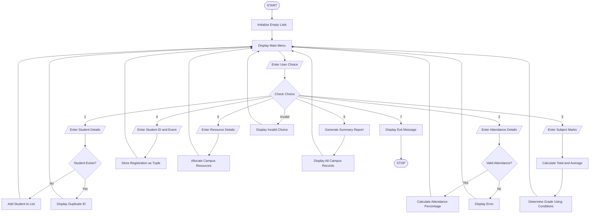

# Comprehensive Smart Campus Management Simulation – Python Program

## 1. Problem Statement

Develop a menu-driven Python application called Smart Campus Management System to manage the major activities of a college campus.

The system integrates the following modules:

1. Student Records: Add and display student details such as ID, name, department, and year.
2. Attendance Management: Record attendance and calculate the attendance percentage of students.
3. Marks Management: Store subject-wise marks and calculate total marks, average, and grades.
4. Event Registration: Register students for campus events and display registered participants.
5. Resource Allocation: Allocate campus resources such as laboratories, classrooms, and projectors.
6. Summary Reporting: Generate a complete report containing student details, attendance, marks, event registrations, and resource allocation.

The program uses conditional statements, loops, strings, lists, nested lists, tuples, and tuple unpacking to perform campus management operations efficiently.

## 2. Algorithm

1. Start the program.
2. Create empty lists to store student records, attendance, marks, event registrations, and resource allocations.
3. Display the main menu.
4. Accept the user's choice.
5. Perform the selected operation:
   - Add Student: Read student ID, name, department, and year. Store the details in a list.
   - Record Attendance: Enter total classes and attended classes. Calculate attendance percentage.
   - Enter Marks: Read three subject marks, calculate total, average, and grade.
   - Event Registration: Accept student ID and event name. Store registration details as a tuple.
   - Resource Allocation: Enter resource name and quantity. Store allocation details.
   - Summary Report: Display all available campus records.
6. Use conditional statements to validate inputs and determine grades.
7. Use loops to repeat menu operations and display records.
8. Continue until the user selects Exit.
9. Display the exit message.
10. Stop.

## 3. Flowchart



## 4. Python Source Code

```
# COMPREHENSIVE SMART CAMPUS MANAGEMENT SYSTEM# Lists to store campus informationstudents = []attendance = []marks = []events = []resources = []# Function to check student existencedef student_exists(sid):    for student in students:        if student[0] == sid:            return True    return False# Function to add student recordsdef add_student():    sid = input("Enter Student ID: ")    if student_exists(sid):        print("Student ID already exists!")        return    name = input("Enter Student Name: ")    dept = input("Enter Department: ")    year = input("Enter Year: ")    students.append([sid, name, dept, year])    print("Student added successfully!")# Function to record attendancedef record_attendance():
```

## 5. Sample Input

The following inputs demonstrate one complete execution of the program.

```
1
2301201
Rahul
CSE
1

2
2301201
80
76

3
2301201
95
90
85

4
2301201
Technical Symposium

5
Projector
2
CSE Seminar Hall

6

7
```

## 6. Sample Output

```
===== SMART CAMPUS MANAGEMENT SYSTEM =====
1. Add Student
2. Record Attendance
3. Enter Marks
4. Register for Event
5. Allocate Resources
6. Summary Report
7. Exit

Enter your choice: 1

Enter Student ID: 2301201
Enter Student Name: Rahul
Enter Department: CSE
Enter Year: 1

Student added successfully!

Enter your choice: 2

Enter Student ID: 2301201
Enter Total Classes: 80
Enter Attended Classes: 76

Attendance recorded successfully!
Attendance Percentage: 95.0 %

Enter your choice: 3

Enter Student ID: 2301201
Enter Subject 1 Marks: 95
Enter Subject 2 Marks: 90
Enter Subject 3 Marks: 85

Marks recorded successfully!
Total Marks: 270.0
Average: 90.0
Grade: A+

Enter your choice: 4

Enter Student ID: 2301201
Enter Event Name: Technical Symposium

Event registration successful!

Enter your choice: 5

Enter Resource Name: Projector
Enter Quantity: 2
Enter Location: CSE Seminar Hall

Resource allocated successfully!

Enter your choice: 6

========== SMART CAMPUS REPORT ==========

--- STUDENT RECORDS ---
ID: 2301201 | Name: Rahul | Department: CSE | Year: 1

--- ATTENDANCE REPORT ---
Student ID: 2301201
Total Classes: 80
Attended Classes: 76
Percentage: 95.0 %

--- MARKS REPORT ---
Student ID: 2301201
Subject Marks: [95.0, 90.0, 85.0]
Total: 270.0
Average: 90.0
Grade: A+

--- EVENT REGISTRATIONS ---
Student ID: 2301201 | Event: Technical Symposium

--- RESOURCE ALLOCATION ---
Resource: Projector
Quantity: 2
Location: CSE Seminar Hall

========== END OF REPORT ==========

Enter your choice: 7

Thank you for using Smart Campus Management System!
```

## 7. Mermaid Flowchart Code


## 8. Python Concepts Used

| Python concept         | Application in program                     |
| ---------------------- | ------------------------------------------ |
| Conditional statements | Menu selection and grade calculation       |
| While loop             | Repeated menu execution                    |
| For loop               | Reading marks and displaying records       |
| Strings                | Student names, departments, and events     |
| Lists                  | Storing student records                    |
| Nested lists           | Storing subject-wise marks                 |
| Tuples                 | Event registration and resource allocation |
| Tuple unpacking        | Retrieving student and resource details    |
| Functions              | Separating different management modules    |
| Arithmetic operators   | Attendance, total marks, and average       |

## 9. Expected Result

The Smart Campus Management System successfully manages student records, attendance, marks, event registrations, and campus resource allocations through a menu-driven Python application.

It generates a consolidated summary report and demonstrates the practical application of conditional statements, loops, strings, lists, nested lists, tuples, and tuple unpacking.

Program completed
