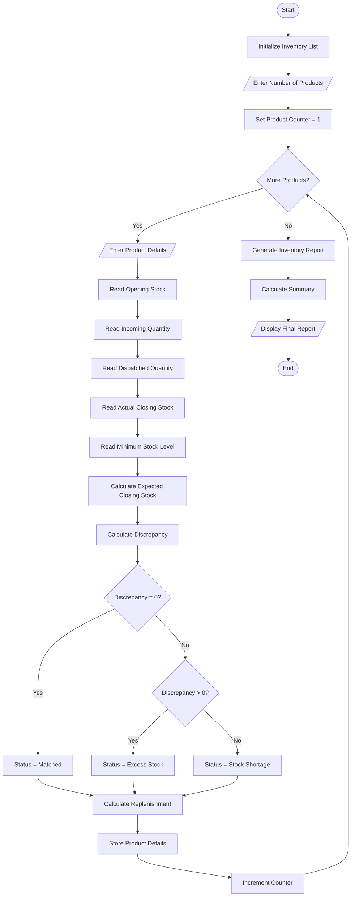

# Warehouse Inventory Reconciliation – Python Program

## 1. Problem Statement

Develop a Python program to perform Warehouse Inventory Reconciliation across multiple products. The program should compare opening stock, incoming quantities, dispatched quantities, and actual closing stock.

The system should:

- Accept inventory details for multiple products.
- Calculate the expected closing stock.
- Compare expected closing stock with actual closing stock.
- Identify inventory discrepancies (shortage or excess).
- Calculate replenishment requirements based on minimum stock levels.
- Generate a final inventory reconciliation report.

Formula:

\\[ Expected\ Closing = Opening + Incoming - Dispatched \\]

\\[ Discrepancy = Actual\ Closing - Expected\ Closing \\]

\\[ Replenishment = \max(0, Minimum\ Stock - Actual\ Closing) \\]

## 2. Algorithm

1. Start the program.
2. Initialize an empty list to store product details.
3. Get the number of products from the user.
4. For each product:
   - Enter product ID and product name.
   - Enter opening stock.
   - Enter incoming quantity.
   - Enter dispatched quantity.
   - Enter actual closing stock.
   - Enter minimum stock level.
5. Calculate expected closing stock.
6. Calculate inventory discrepancy.
7. Determine inventory status:
   - If discrepancy = 0, display "Matched".
   - If discrepancy is positive, display "Excess Stock".
   - If discrepancy is negative, display "Stock Shortage".
8. Calculate replenishment quantity.
9. Store all product details in a list.
10. Display the inventory reconciliation report.
11. Display total products, discrepancies, and replenishment requirements.
12. Stop the program.

## 3. Flowchart


## 4. Python Source Code

```
# Warehouse Inventory Reconciliationinventory = []print("===== WAREHOUSE INVENTORY RECONCILIATION =====")n = int(input("Enter number of products: "))for i in range(n):    print("\nEnter details for Product", i + 1)    product_id = input("Product ID: ")    product_name = input("Product Name: ")    opening = int(input("Opening Stock: "))    incoming = int(input("Incoming Quantity: "))    dispatched = int(input("Dispatched Quantity: "))    actual_closing = int(input("Actual Closing Stock: "))    minimum_stock = int(input("Minimum Stock Level: "))    # Calculate expected closing stock    expected = opening + incoming - dispatched    # Calculate discrepancy    discrepancy = actual_closing - expected    # Identify stock status    if discrepancy == 0:        status = "Matched"    elif discrepancy > 0:        status = "Excess Stock"    else:        status = "Stock Shortage"    # Calculate replenishment requirement
```

## 5. Sample Input

```
===== WAREHOUSE INVENTORY RECONCILIATION =====
Enter number of products: 3

Enter details for Product 1
Product ID: P101
Product Name: Laptop
Opening Stock: 100
Incoming Quantity: 50
Dispatched Quantity: 30
Actual Closing Stock: 120
Minimum Stock Level: 50

Enter details for Product 2
Product ID: P102
Product Name: Keyboard
Opening Stock: 80
Incoming Quantity: 20
Dispatched Quantity: 40
Actual Closing Stock: 50
Minimum Stock Level: 70

Enter details for Product 3
Product ID: P103
Product Name: Mouse
Opening Stock: 60
Incoming Quantity: 30
Dispatched Quantity: 20
Actual Closing Stock: 75
Minimum Stock Level: 40
```

## 6. Sample Output

```
========== INVENTORY REPORT ==========

ID       Product      Opening    Incoming   Dispatch   Expected   Actual       Difference
P101     Laptop       100        50         30         120        120          0
Status: Matched
Replenishment Required: 0
--------------------------------------

P102     Keyboard     80         20         40         60         50           -10
Status: Stock Shortage
Replenishment Required: 20
--------------------------------------

P103     Mouse        60         30         20         70         75           5
Status: Excess Stock
Replenishment Required: 0
--------------------------------------

========== FINAL SUMMARY ==========
Total Products: 3
Matched Products: 1
Products with Shortage: 1
Products with Excess: 1
Total Replenishment Required: 20

Inventory Reconciliation Completed!
```

## 7. Mermaid Flowchart Code


## 8. Python Concepts Used

| Concept              | Application                    |
| -------------------- | ------------------------------ |
| Variables            | Store inventory quantities     |
| Input statements     | Accept product details         |
| Lists                | Store multiple product records |
| For loop             | Process multiple products      |
| If-elif-else         | Identify stock discrepancies   |
| Arithmetic operators | Calculate expected stock       |
| `max()` function     | Calculate replenishment        |
| `sum()` function     | Calculate summary totals       |
| Formatted strings    | Display inventory reports      |

Result: The program successfully reconciles warehouse inventory, identifies matched stock, excess stock and shortages, and calculates the replenishment requirements for multiple products.
