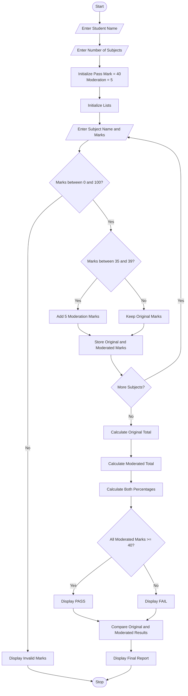

# University Examination Result Moderation

## 1. Problem Statement

Develop a Python program to process university examination marks across multiple subjects and apply specified moderation rules. The program should:

- Accept student details and marks in multiple subjects.
- Calculate the original total and percentage.
- Apply moderation rules to subjects where marks are below the pass mark.
- Add moderation marks without exceeding the maximum subject marks.
- Calculate the moderated total and percentage.
- Compare original and moderated results.
- Display the final result and moderation summary.

Moderation Rules:

1. Pass mark for each subject is 40.
2. If a student scores between 35 and 39, add 5 moderation marks.
3. If a student scores below 35, no moderation is given.
4. Moderated marks must not exceed 100.
5. A student passes if all subjects have at least 40 marks after moderation.

## 2. Algorithm

1. Start the program.
2. Read the student name and number of subjects.
3. Set the pass mark to 40.
4. Set moderation marks to 5.
5. Create an empty list to store original and moderated marks.
6. Repeat for each subject:
   - Read subject name and original marks.
   - Check whether marks are between 35 and 39.
   - If true, add 5 moderation marks.
   - Ensure marks do not exceed 100.
   - Store original and moderated marks.
7. Calculate original total and percentage.
8. Calculate moderated total and percentage.
9. Check whether all moderated subject marks are at least 40.
10. Display original marks and moderated marks.
11. Display the improvement in total marks.
12. Display the final result.
13. Stop.

## 3. Flowchart


## 4. Python Source Code

```
# University Examination Result Moderationprint("======================================")print(" UNIVERSITY EXAMINATION RESULT")print("          MODERATION SYSTEM")print("======================================")student_name = input("Enter Student Name: ")n = int(input("Enter Number of Subjects: "))pass_mark = 40moderation = 5subjects = []original_marks = []moderated_marks = []# Input subject detailsfor i in range(n):    print("\nSubject", i + 1)    subject = input("Enter Subject Name: ")    marks = int(input("Enter Original Marks (0-100): "))    if marks < 0 or marks > 100:        print("Invalid marks! Enter marks between 0 and 100.")        exit()    # Apply moderation    if 35 <= marks < pass_mark:        new_marks = min(marks + moderation, 100)    else:        new_marks = marks    subjects.append(subject)
```

## 5. Sample Input

```
Enter Student Name: Rahul
Enter Number of Subjects: 5

Subject 1
Enter Subject Name: Mathematics
Enter Original Marks (0-100): 38

Subject 2
Enter Subject Name: Physics
Enter Original Marks (0-100): 65

Subject 3
Enter Subject Name: Chemistry
Enter Original Marks (0-100): 36

Subject 4
Enter Subject Name: Python
Enter Original Marks (0-100): 82

Subject 5
Enter Subject Name: English
Enter Original Marks (0-100): 45
```

## 6. Sample Output

```
======================================
       EXAMINATION RESULT REPORT
======================================
Student Name: Rahul

Subject-wise Marks
--------------------------------------
Subject       Original   Moderated
--------------------------------------
Mathematics   38         43
Physics       65         65
Chemistry     36         41
Python        82         82
English       45         45
--------------------------------------
Original Total: 266
Moderated Total: 276

Original Percentage: 53.2 %
Moderated Percentage: 55.2 %
Marks Improved: 10

Original Result: FAIL
Moderated Result: PASS

======================================
          END OF REPORT
======================================
```

## 7. Mermaid Flowchart Code


## 8. Concepts Used in This Program

| Python concept | Application                                           |
| -------------- | ----------------------------------------------------- |
| Variables      | Store student details and marks                       |
| Input          | Accept student information                            |
| Lists          | Store subject names and marks                         |
| For loop       | Process multiple subjects                             |
| If-else        | Apply moderation rules                                |
| `min()`        | Restrict maximum marks                                |
| `sum()`        | Calculate total marks                                 |
| `all()`        | Check pass eligibility                                |
| Functions      | Calculate totals and results using built-in functions |

Expected result: The program compares original and moderated marks, calculates percentages, and determines whether the student passes after moderation.
