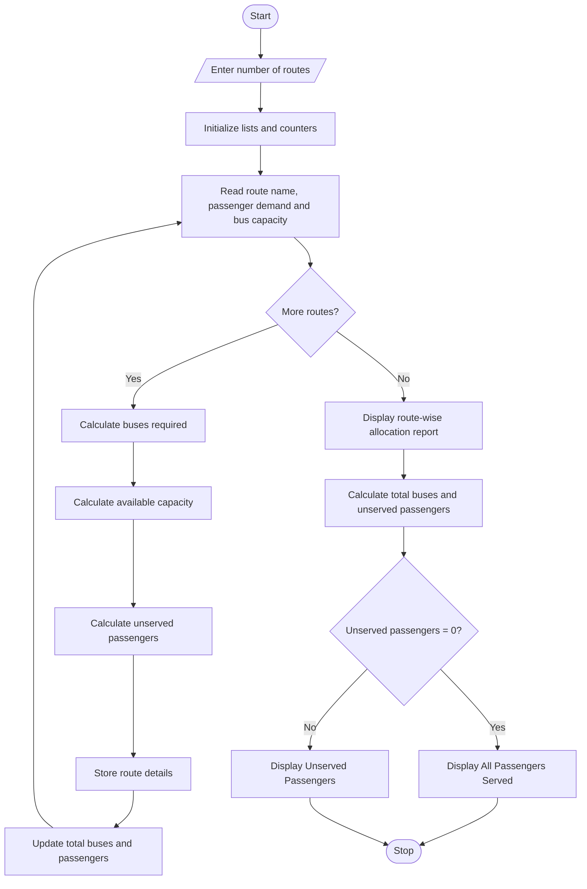

# Campus Transport Allocation System – Python Program

## 1. Problem Statement

Develop a Python program to allocate buses for multiple campus transport routes based on passenger demand and bus capacity. The program should calculate the number of buses required for each route, determine the total number of buses needed, identify the number of unserved passengers, and generate a final transport allocation report.

The program uses conditional statements, loops, lists, and mathematical operations to manage bus allocation efficiently.

## 2. Algorithm

1. Start the program.
2. Read the number of transport routes.
3. Create empty lists to store route names, passenger demands, and bus allocations.
4. For each route:
   - Read the route name.
   - Read the number of passengers.
   - Read the bus capacity.
5. Calculate the number of buses required using ceiling division.
6. Calculate the total available capacity.
7. Calculate the number of unserved passengers.
8. Store all route details in lists.
9. Display the route-wise allocation report.
10. Calculate the total number of buses required.
11. Calculate the total number of unserved passengers.
12. Display the final summary.
13. Stop the program.

## 3. Flowchart


## 4. Python Source Code

```
# Campus Transport Allocation Systemprint("===== CAMPUS TRANSPORT ALLOCATION =====")routes = []demands = []capacities = []buses_required = []unserved_passengers = []n = int(input("Enter number of routes: "))total_buses = 0total_unserved = 0for i in range(n):    print("\nRoute", i + 1)    route = input("Enter route name: ")    passengers = int(input("Enter passenger demand: "))    capacity = int(input("Enter bus capacity: "))    # Calculate buses required    buses = (passengers + capacity - 1) // capacity    # Calculate unserved passengers    available_capacity = buses * capacity    unserved = max(0, passengers - available_capacity)    routes.append(route)    demands.append(passengers)    capacities.append(capacity)    buses_required.append(buses)    unserved_passengers.append(unserved)
```

## 5. Sample Input

```
Enter number of routes: 3

Route 1
Enter route name: Route A
Enter passenger demand: 100
Enter bus capacity: 50

Route 2
Enter route name: Route B
Enter passenger demand: 120
Enter bus capacity: 40

Route 3
Enter route name: Route C
Enter passenger demand: 75
Enter bus capacity: 30
```

## 6. Sample Output

```
===== CAMPUS TRANSPORT ALLOCATION =====

===== TRANSPORT ALLOCATION REPORT =====

Route   Demand  Capacity  Buses  Unserved
Route A 100     50        2      0
Route B 120     40        3      0
Route C 75      30        3      0

===== FINAL SUMMARY =====
Total Routes: 3
Total Buses Required: 8
Total Passengers: 295
Total Unserved Passengers: 0
Status: All passengers are served.
===== END OF REPORT =====
```

## 7. Mermaid Flowchart Code


## 8. Expected Result

The program successfully:

- Calculates buses required for each campus route.
- Considers passenger demand and bus capacity.
- Displays route-wise bus allocation.
- Identifies unserved passengers.
- Generates a final transport summary.

Note: This program assumes buses can be allocated in sufficient numbers, so unserved passengers will always be zero. If the campus has a fixed bus fleet, the program can be extended to allocate only the available buses and identify passengers who cannot be accommodated.
