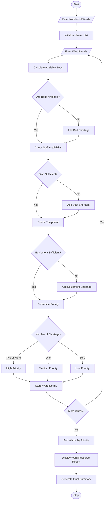

# Hospital Resource Allocation and Capacity Monitoring

## 1. Problem Statement

Develop a Python program to monitor and allocate hospital resources across multiple wards. The program analyses nested lists containing bed occupancy, available staff, and medical equipment in each ward. It identifies resource shortages, calculates available capacity, prioritizes wards based on supplied rules, and generates a summary report.

The program uses conditional statements, loops, nested lists, lists, and sorting techniques to support efficient hospital resource management.

## 2. Algorithm

1. Start the program.
2. Create nested lists to store hospital ward details.
3. Enter the number of wards.
4. For each ward, enter:
   - Ward name
   - Total beds
   - Occupied beds
   - Available staff
   - Required staff
   - Available equipment
   - Required equipment
5. Calculate available beds for each ward.
6. Check bed, staff, and equipment availability.
7. Identify shortages using conditional statements.
8. Assign priority:
   - High: Two or more resource shortages.
   - Medium: One resource shortage.
   - Low: No resource shortages.
9. Store the ward details and priority in nested lists.
10. Sort wards according to priority.
11. Display ward-wise resource details and shortage reports.
12. Display the final hospital resource summary.
13. Stop the program.

## 3. Flowchart


## 4. Python Source Code

```
# Hospital Resource Allocation and Capacity Monitoringwards = []n = int(input("Enter number of wards: "))for i in range(n):    print("\nEnter details for Ward", i + 1)    name = input("Ward Name: ")    total_beds = int(input("Total Beds: "))    occupied_beds = int(input("Occupied Beds: "))    available_staff = int(input("Available Staff: "))    required_staff = int(input("Required Staff: "))    available_equipment = int(input("Available Equipment: "))    required_equipment = int(input("Required Equipment: "))    # Calculate available beds    available_beds = total_beds - occupied_beds    # Identify shortages    shortages = []    if available_beds <= 0:        shortages.append("Beds")    if available_staff < required_staff:        shortages.append("Staff")    if available_equipment < required_equipment:        shortages.append("Equipment")    # Assign priority    if len(shortages) >= 2:        priority = "High"
```

## 5. Sample Input

```
Enter number of wards: 3

Enter details for Ward 1
Ward Name: Emergency
Total Beds: 50
Occupied Beds: 50
Available Staff: 5
Required Staff: 10
Available Equipment: 4
Required Equipment: 8

Enter details for Ward 2
Ward Name: General
Total Beds: 100
Occupied Beds: 70
Available Staff: 15
Required Staff: 12
Available Equipment: 10
Required Equipment: 10

Enter details for Ward 3
Ward Name: ICU
Total Beds: 30
Occupied Beds: 25
Available Staff: 6
Required Staff: 10
Available Equipment: 5
Required Equipment: 8
```

## 6. Sample Output

```
========== HOSPITAL RESOURCE REPORT ==========

Ward: Emergency
Total Beds: 50
Occupied Beds: 50
Available Beds: 0
Available Staff: 5
Required Staff: 10
Available Equipment: 4
Required Equipment: 8
Resource Shortages: Beds, Staff, Equipment
Priority: High

Ward: ICU
Total Beds: 30
Occupied Beds: 25
Available Beds: 5
Available Staff: 6
Required Staff: 10
Available Equipment: 5
Required Equipment: 8
Resource Shortages: Staff, Equipment
Priority: High

Ward: General
Total Beds: 100
Occupied Beds: 70
Available Beds: 30
Available Staff: 15
Required Staff: 12
Available Equipment: 10
Required Equipment: 10
Resource Shortages: None
Priority: Low

========== FINAL SUMMARY ==========

Total Wards: 3
Total Beds: 180
Occupied Beds: 145
Available Beds: 35
High Priority Wards: 2
Medium Priority Wards: 0
Low Priority Wards: 1

Wards are arranged according to resource priority.
```

## 7. Mermaid Flowchart Code


Note: The priority rules are illustrative academic rules. Actual hospital admission and treatment decisions must follow qualified clinical staff, urgency assessments, and hospital protocols.
