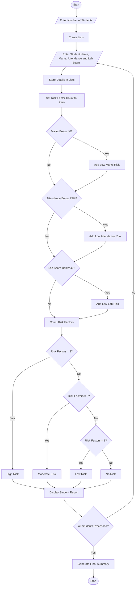

# Student Academic Risk Classification System – Python Program

## 1. Problem Statement

Develop a Python program to classify students based on their academic performance using marks, attendance percentage, and laboratory scores.

The system accepts student details and their academic scores using lists. It identifies students who are at academic risk based on predefined conditions, detects multiple simultaneous risk factors, classifies students into different risk categories, and generates a summary report.

Risk classification criteria:

| Criteria         | Risk condition |
| ---------------- | -------------- |
| Marks            | Below 40       |
| Attendance       | Below 75%      |
| Laboratory score | Below 40       |

Risk categories:

- High Risk: Three risk factors.
- Moderate Risk: Two risk factors.
- Low Risk: One risk factor.
- No Risk: No risk factors.

## 2. Algorithm

1. Start the program.
2. Get the number of students.
3. Create lists to store student names, marks, attendance, and laboratory scores.
4. Read each student's name and academic details.
5. Store the details in their respective lists.
6. Check each student's marks, attendance, and laboratory score.
7. Identify the number of risk factors.
8. Classify students:
   - If risk factors = 3, classify as High Risk.
   - If risk factors = 2, classify as Moderate Risk.
   - If risk factors = 1, classify as Low Risk.
   - Otherwise, classify as No Risk.
9. Display individual student risk reports.
10. Calculate the total number of students in each category.
11. Display the final summary report.
12. Stop the program.

## 3. Flowchart

## 4. Python Source Code

```
# Student Academic Risk Classification System# Lists to store student detailsnames = []marks = []attendance = []lab_scores = []# Risk category countershigh_risk = 0moderate_risk = 0low_risk = 0no_risk = 0# Get number of studentsn = int(input("Enter number of students: "))# Input student detailsfor i in range(n):    print("\nEnter details of Student", i + 1)    name = input("Enter student name: ")    mark = float(input("Enter marks: "))    attend = float(input("Enter attendance percentage: "))    lab = float(input("Enter laboratory score: "))    names.append(name)    marks.append(mark)    attendance.append(attend)    lab_scores.append(lab)# Academic risk classificationprint("\n========== STUDENT RISK REPORT ==========")for i in range(n):
```

## 5. Sample Input

```
Enter number of students: 5

Enter details of Student 1
Enter student name: Arun
Enter marks: 85
Enter attendance percentage: 90
Enter laboratory score: 80

Enter details of Student 2
Enter student name: Banu
Enter marks: 35
Enter attendance percentage: 65
Enter laboratory score: 30

Enter details of Student 3
Enter student name: Charan
Enter marks: 55
Enter attendance percentage: 70
Enter laboratory score: 60

Enter details of Student 4
Enter student name: Divya
Enter marks: 35
Enter attendance percentage: 80
Enter laboratory score: 30

Enter details of Student 5
Enter student name: Esha
Enter marks: 75
Enter attendance percentage: 85
Enter laboratory score: 90
```

## 6. Sample Output

```
========== STUDENT RISK REPORT ==========

Student Name: Arun
Marks: 85.0
Attendance: 90.0 %
Lab Score: 80.0
Risk Factors: None
Risk Category: No Risk

Student Name: Banu
Marks: 35.0
Attendance: 65.0 %
Lab Score: 30.0
Risk Factors: Low Marks, Low Attendance, Low Lab Score
Risk Category: High Risk

Student Name: Charan
Marks: 55.0
Attendance: 70.0 %
Lab Score: 60.0
Risk Factors: Low Attendance
Risk Category: Low Risk

Student Name: Divya
Marks: 35.0
Attendance: 80.0 %
Lab Score: 30.0
Risk Factors: Low Marks, Low Lab Score
Risk Category: Moderate Risk

Student Name: Esha
Marks: 75.0
Attendance: 85.0 %
Lab Score: 90.0
Risk Factors: None
Risk Category: No Risk

========== FINAL SUMMARY ==========
Total Students: 5
High Risk Students: 1
Moderate Risk Students: 1
Low Risk Students: 1
No Risk Students: 2

Academic Risk Analysis Completed.
```

## 7. Mermaid Flowchart Code


## 8. Concepts Used in This Program

| Python concept         | Application                             |
| ---------------------- | --------------------------------------- |
| Lists                  | Store student details                   |
| Strings                | Store student names and risk categories |
| Loops                  | Process multiple students               |
| Conditional statements | Classify academic risks                 |
| Nested conditions      | Check multiple risk factors             |
| List methods           | Append student details                  |
| Built-in functions     | `len()` and `range()`                   |
| Counters               | Calculate risk category totals          |

Result: The Student Academic Risk Classification System successfully evaluates student marks, attendance, and laboratory scores, identifies multiple risk factors, classifies students into four risk categories, and generates a final academic risk summary.
